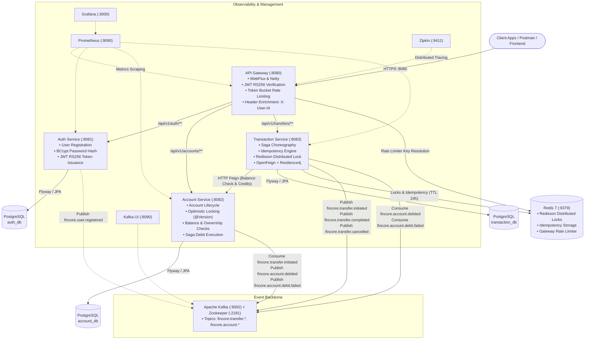
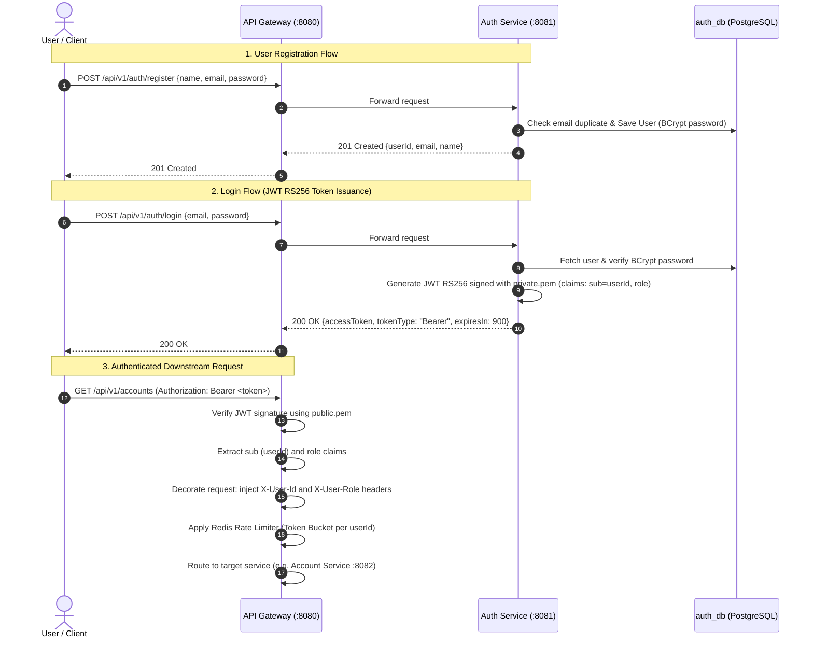
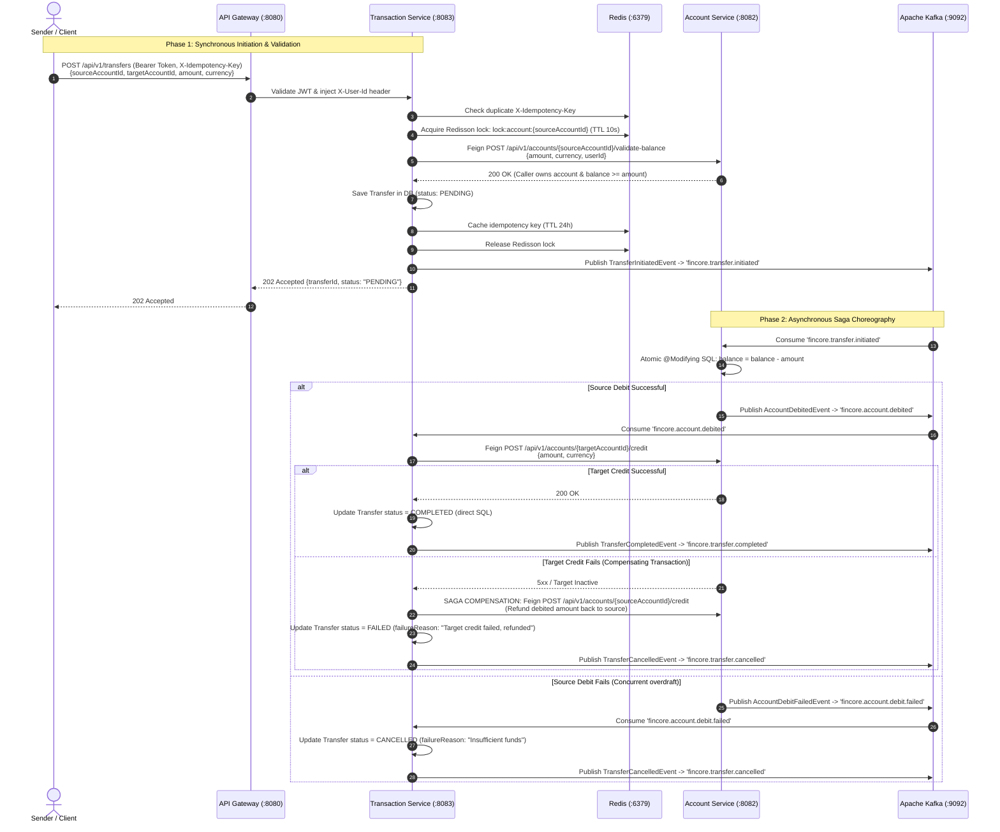

# ArthSetu — Distributed Digital Banking Platform

> A production-grade microservices backend for a digital banking core, built with Java 21, Spring Boot 3.3.5, Apache Kafka, and AWS. Demonstrates real-world fintech engineering patterns including Saga choreography, idempotency, distributed locking, and event-driven architecture.

---

## Table of Contents

- [Overview](#overview)
- [Architecture](#architecture)
- [Tech Stack](#tech-stack)
- [Project Structure](#project-structure)
- [Microservices](#microservices)
- [Key Engineering Decisions](#key-engineering-decisions)
- [Getting Started](#getting-started)
- [API Reference](#api-reference)
- [Kafka Topics & Events](#kafka-topics--events)
- [Transfer Flow — Saga Choreography](#transfer-flow--saga-choreography)
- [Running Tests](#running-tests)
- [Portfolio Engineering Contributions & Enhancements](#portfolio-engineering-contributions--enhancements)
- [Deployment — AWS](#deployment--aws)
- [Roadmap](#roadmap)
- [Author](#author)

---

## Overview

FinCore is a digital banking core that allows users to:

- Register and authenticate with JWT RS256 (asymmetric cryptography)
- Create savings and checking accounts in PEN or USD
- Transfer money between accounts with full consistency guarantees (Saga choreography)
- Query account balances and transfer histories with strict caller ownership validation
- Ensure zero double-debiting via distributed locks (Redisson) and idempotency keys (Redis)
- Handle partial distributed failures with automated compensating transactions (refunds)

---

## Architecture

### High-Level System Architecture



### Authentication & Token Propagation Flow



**Patterns applied:**

| Pattern | Where | Why |
|---|---|---|
| Event-Driven Architecture | Kafka between services | Temporal decoupling, asynchronous processing, and fault resilience |
| Saga Choreography | Transfer flow | Distributed transactions across microservices without 2-Phase Commit (2PC) |
| Hexagonal Architecture | Every service | Strict separation of domain entities, ports, and infrastructure adapters |
| Database per Service | 4 isolated PostgreSQL DBs | Complete service autonomy and schema isolation |
| Idempotency Keys | Transfer endpoint | Prevent double debiting on network retries or duplicate client submissions |
| Distributed Lock | Before transfer initiation | Prevent race conditions and simultaneous balance drainage across instances |
| Circuit Breaker | OpenFeign client calls | Fault tolerance with Resilience4j; fast fallback if dependencies fail |
| Optimistic Locking | Account balance (`@Version`) | DB-level concurrent update protection for account entities |

---

## Tech Stack

| Category | Technology | Version |
|---|---|---|
| Language | Java | 21 |
| Framework | Spring Boot | 3.3.5 |
| Spring Cloud | Spring Cloud (Gateway, OpenFeign) | 2023.0.3 |
| Gateway | Spring Cloud Gateway (WebFlux / Netty) | 4.1.5 |
| Messaging | Apache Kafka + Zookeeper | 3.7.1 / 7.6.0 |
| Database | PostgreSQL | 15 (Docker) |
| Cache & Locks | Redis + Redisson | Redis 7 / Redisson 3.31 |
| HTTP Client | OpenFeign + Resilience4j | 2.1.0 |
| Authentication | JWT RS256 (JJWT) | 0.12.5 |
| DB Migrations | Flyway | 10.11 |
| Build Tool | Gradle (Multi-module) | 9.0 |
| Containers | Docker + Docker Compose | Compose 3.8 |
| Observability | Prometheus + Grafana + Zipkin + Kafka UI | Prometheus 2.52 / Grafana 10.4 |
| Cloud Target | AWS ECS Fargate + RDS + ElastiCache + MSK | Production Blueprint |

---

## Project Structure

```
fincore-digital-banking-platform/
├── api-gateway/            # Port 8080 — Spring Cloud Gateway, JWT RS256 filter, Redis rate limiting
├── auth-service/           # Port 8081 — User identity, BCrypt hashing, JWT RS256 signing (private.pem)
├── account-service/        # Port 8082 — Accounts, optimistic locking, Saga debit consumer, balance validation
├── transaction-service/    # Port 8083 — Saga choreography, Redisson distributed lock, idempotency cache
├── config-server/          # Port 8888 — Spring Cloud Config Server with Kafka bus refresh support
├── audit-service/          # Skeleton module — Event-driven audit trail consumer (fincore.* topics)
├── notification-service/   # Skeleton module — Event-driven customer notification consumer
├── docker/                 # Monitoring configurations & PostgreSQL database initialization scripts
├── docker-compose.yml      # Local infrastructure orchestration (Postgres, Redis, Kafka, Zookeeper, etc.)
├── build.gradle            # Monorepo Gradle build configuration (Spring Boot 3.3.5)
└── README.md
```

---

## Microservices

### API Gateway — Port 8080

The single public entry point for all client requests.
- Validates incoming JWT RS256 tokens using the RSA public key (`public.pem`).
- Decodes token claims (`sub` as `userId` and `role`) and injects them as trusted downstream headers (`X-User-Id`, `X-User-Role`).
- Implements token bucket rate limiting per authenticated user backed by Redis (10 req/s replenish rate, burst capacity of 20).
- Downstream services never validate JWTs directly — they enforce authorization based on trusted gateway headers.

### Auth Service — Port 8081

Handles user registration and authentication.
- Stores user credentials in `auth_db` with BCrypt password hashing.
- Issues JWT tokens signed with a 2048-bit RSA private key (`private.pem`). The private key never leaves this service.
- Publishes `fincore.user.registered` events to Kafka upon successful account registration.

### Account Service — Port 8082

Manages bank account lifecycles and ledger balances.
- Supports `SAVINGS` and `CHECKING` accounts in `PEN` and `USD`.
- Uses `@Version` optimistic locking on the `Account` entity for concurrent database protection.
- Exposes synchronous internal endpoints for balance validation and credit execution.
- Listens to `fincore.transfer.initiated` on Kafka to execute atomic account debits using direct `@Modifying` JPQL queries to avoid JPA EntityManager cache staleness.
- Emits `fincore.account.debited` on success or `fincore.account.debit.failed` on overdraft / failure.

### Transaction Service — Port 8083

Orchestrates inter-account money transfers using Saga choreography.
- **Idempotency check:** Inspects Redis and `transaction_db` for previously submitted `X-Idempotency-Key` headers.
- **Distributed lock:** Acquires a distributed lock on the source account via Redisson (`lock:account:{sourceAccountId}`) with a 5-second wait time and 10-second lease to eliminate concurrent overdraft attempts across instances.
- **Synchronous balance check:** Calls Account Service via OpenFeign to verify sufficient balance and confirm that the caller owns the source account.
- **Saga initiation:** Persists the transfer with status `PENDING`, caches the key in Redis (TTL 24h), releases the lock, and publishes `TransferInitiatedEvent` to Kafka before returning `202 Accepted`.
- **Saga completion:** Consumes `fincore.account.debited` → credits target account via Feign → updates status to `COMPLETED` → publishes `fincore.transfer.completed`.
- **Saga compensation:** If crediting the target account fails, initiates an automated compensating transaction to refund the source account, marks status as `FAILED`, and publishes `fincore.transfer.cancelled`.

### Config Server — Port 8888

Spring Cloud Config Server with support for native classpath configuration and Kafka Cloud Bus for distributed configuration refresh (`/actuator/busrefresh`).

### Audit & Notification Services

Monorepo placeholder modules designed to asynchronously consume Kafka event streams (`fincore.user.registered`, `fincore.transfer.completed`, `fincore.transfer.cancelled`) for immutable audit logging and user alerting.

---

## Key Engineering Decisions

### Why Saga Choreography over Orchestration?

An orchestrator is a single point of failure and introduces tight coupling. With choreography, each service reacts to Kafka events independently. If Transaction Service is temporarily restarted, Account Service still processes events from its Kafka partition — nothing is lost, only delayed.

### Why two concurrency mechanisms?

- **Distributed lock** (Redisson, before DB): Prevents two concurrent requests across multiple instances of Transaction Service from simultaneously passing balance validation for the same account.
- **Optimistic locking** (`@Version`, at DB): Prevents two JPA operations from overwriting each other at the database level.
Both solve distinct failure modes: distributed locking protects application workflow boundaries, while optimistic locking protects low-level database consistency.

### Why `@Modifying` JPQL UPDATE for debit/credit?

JPA's `EntityManager` caches entities in its persistence context. When an HTTP thread loads an account entity and a Kafka consumer thread simultaneously tries to save a different instance of the same entity (same UUID), JPA throws `NonUniqueObjectException`. A direct `UPDATE` statement bypasses the JPA first-level cache entirely, which is the correct pattern for Kafka consumers that modify entities concurrently.

### Why JWT RS256 over HS256?

HS256 requires all verifying services to share the same symmetric secret key — if any service is compromised, an attacker can forge administrative tokens. With RS256, only Auth Service holds the RSA private key for signing. All other services (and the API Gateway) hold only the public key (`public.pem`). They can verify authenticity but can never forge tokens.

### Why `REQUIRES_NEW` propagation in Kafka consumer handlers?

When a `@Transactional` method fails, Spring marks the underlying physical transaction as `rollback-only`. If an outer transaction calls a failing child method, the outer transaction is marked for rollback even if the exception is caught. `@Transactional(propagation = Propagation.REQUIRES_NEW)` guarantees an independent physical transaction so that consumer failures or compensating actions execute in a clean transaction boundary.

### Resilience4j Circuit Breaker with 4xx Bypass

OpenFeign client calls from Transaction Service to Account Service are protected by Resilience4j circuit breakers. Business validation responses (such as `403 Forbidden` for ownership mismatches or `422 Unprocessable Entity` for insufficient funds) are explicitly mapped as client exceptions rather than downstream infrastructure faults. This prevents transient client validation errors from tripping the circuit breaker open.

---

## Getting Started

### Prerequisites

- **Java 21** (JDK 21 with preview features supported)
- **Docker Desktop** (Engine 24+, Compose v2)
- **Gradle 9** (or the included `./gradlew` wrapper)
- **OpenSSL** (for RSA key pair generation)

### 1. Clone the repository

```bash
git clone https://github.com/Krit2004-alt/arthsetu-digital-banking-platform.git
cd arthsetu-digital-banking-platform
```

### 2. Generate RSA keys for JWT

The platform uses 2048-bit RSA keys for JWT RS256 authentication. Generate the key pair and distribute the public key to verifying services:

**Linux / macOS (Bash):**
```bash
mkdir -p auth-service/src/main/resources/keys
cd auth-service/src/main/resources/keys

openssl genrsa -out private.pem 2048
openssl rsa -in private.pem -pubout -out public.pem

# Copy public key to services that verify tokens
mkdir -p ../../../../../api-gateway/src/main/resources/keys
mkdir -p ../../../../../account-service/src/main/resources/keys
mkdir -p ../../../../../transaction-service/src/main/resources/keys

cp public.pem ../../../../../api-gateway/src/main/resources/keys/
cp public.pem ../../../../../account-service/src/main/resources/keys/
cp public.pem ../../../../../transaction-service/src/main/resources/keys/

cd ../../../../..
```

**Windows (PowerShell):**
```powershell
New-Item -ItemType Directory -Force -Path auth-service\src\main\resources\keys
cd auth-service\src\main\resources\keys

openssl genrsa -out private.pem 2048
openssl rsa -in private.pem -pubout -out public.pem

New-Item -ItemType Directory -Force -Path ..\..\..\..\..\api-gateway\src\main\resources\keys
New-Item -ItemType Directory -Force -Path ..\..\..\..\..\account-service\src\main\resources\keys
New-Item -ItemType Directory -Force -Path ..\..\..\..\..\transaction-service\src\main\resources\keys

Copy-Item public.pem ..\..\..\..\..\api-gateway\src\main\resources\keys\
Copy-Item public.pem ..\..\..\..\..\account-service\src\main\resources\keys\
Copy-Item public.pem ..\..\..\..\..\transaction-service\src\main\resources\keys\

cd ..\..\..\..\..
```

### 3. Start infrastructure

```bash
# Start Docker infrastructure (PostgreSQL, Redis, Kafka, Zookeeper, Kafka UI, Zipkin, Prometheus, Grafana)
docker-compose up -d
```

> **Note on Local PostgreSQL Conflicts:** If you have a local PostgreSQL instance running natively on port 5432, stop it before starting Docker (`sudo systemctl stop postgresql` on Linux or `net stop postgresql-x64-17` on Windows), or start services passing `-Dspring.datasource.url=jdbc:postgresql://<docker-host-ip>:5432/<db>`.

Verify containers are healthy:
```bash
docker-compose ps
```

### 4. Build the complete project

```bash
# Linux / macOS
./gradlew build -x test

# Windows
.\gradlew.bat build -x test
```

### 5. Start the microservices

Run each service in a separate terminal:

**Terminal 1 — Auth Service (Port 8081):**
```bash
./gradlew auth-service:bootRun
# Windows: .\gradlew.bat auth-service:bootRun
```

**Terminal 2 — Account Service (Port 8082):**
```bash
./gradlew account-service:bootRun
# Windows: .\gradlew.bat account-service:bootRun
```

**Terminal 3 — Transaction Service (Port 8083):**
```bash
./gradlew transaction-service:bootRun
# Windows: .\gradlew.bat transaction-service:bootRun
```

**Terminal 4 — API Gateway (Port 8080):**
```bash
./gradlew api-gateway:bootRun
# Windows: .\gradlew.bat api-gateway:bootRun
```

### 6. Verify health endpoints

```bash
curl http://localhost:8080/actuator/health
curl http://localhost:8081/actuator/health
curl http://localhost:8082/actuator/health
curl http://localhost:8083/actuator/health
```

All endpoints should respond with `{"status":"UP"}`.

---

## API Reference

All client requests enter through the API Gateway at `http://localhost:8080`.

### Auth Endpoints

#### Register User
```http
POST /api/v1/auth/register
Content-Type: application/json

{
  "name": "Alice Johnson",
  "email": "alice@test.com",
  "password": "Password123!"
}
```
*Response (`201 Created`):*
```json
{
  "userId": "92321ebd-7d52-43f6-ab05-98549aea6dc1",
  "email": "alice@test.com",
  "name": "Alice Johnson"
}
```

#### Login
```http
POST /api/v1/auth/login
Content-Type: application/json

{
  "email": "alice@test.com",
  "password": "Password123!"
}
```
*Response (`200 OK`):*
```json
{
  "accessToken": "eyJhbGciOiJSUzI1NiJ9...",
  "tokenType": "Bearer",
  "expiresIn": 900
}
```

---

### Account Endpoints

#### Create Account
```http
POST /api/v1/accounts
Authorization: Bearer {token}
Content-Type: application/json

{
  "type": "SAVINGS",
  "currency": "PEN"
}
```
*Response (`201 Created`):*
```json
{
  "id": "cb7775eb-7a9c-4e1d-80cb-9137040deb89",
  "accountNumber": "ACC-00000000001",
  "type": "SAVINGS",
  "currency": "PEN",
  "balance": 0.00,
  "status": "ACTIVE",
  "createdAt": "2026-10-15T01:30:00"
}
```

#### List Accounts for Authenticated User
```http
GET /api/v1/accounts
Authorization: Bearer {token}
```
*Response (`200 OK`):*
```json
[
  {
    "id": "cb7775eb-7a9c-4e1d-80cb-9137040deb89",
    "accountNumber": "ACC-00000000001",
    "type": "SAVINGS",
    "currency": "PEN",
    "balance": 500.00,
    "status": "ACTIVE",
    "createdAt": "2026-10-15T01:30:00"
  }
]
```

#### Get Account Balance
```http
GET /api/v1/accounts/{accountId}/balance
Authorization: Bearer {token}
```
*Response (`200 OK`):* Returns account details with current balance.
*Security:* Returns `403 Forbidden` (`UNAUTHORIZED_ACCOUNT_ACCESS`) if caller is not the owner.

#### Credit Account (Funds Deposit)
```http
POST /api/v1/accounts/{accountId}/credit
Authorization: Bearer {token}
Content-Type: application/json

{
  "amount": 500.00,
  "currency": "PEN"
}
```
*Response (`200 OK`):* Balance credited.

---

### Transfer Endpoints

#### Initiate Money Transfer
```http
POST /api/v1/transfers
Authorization: Bearer {token}
Content-Type: application/json
X-Idempotency-Key: 9b1deb4d-3b7d-4bad-9bdd-2b0d7b3dcb6d

{
  "sourceAccountId": "cb7775eb-7a9c-4e1d-80cb-9137040deb89",
  "targetAccountId": "a2527c16-72c8-40fb-9c09-b8feadbfb931",
  "amount": 50.00,
  "currency": "PEN",
  "description": "Payment for lunch"
}
```
*Response (`202 Accepted`):*
```json
{
  "transferId": "3d6e228f-6288-405a-aed2-9eb33796af64",
  "sourceAccountId": "cb7775eb-7a9c-4e1d-80cb-9137040deb89",
  "targetAccountId": "a2527c16-72c8-40fb-9c09-b8feadbfb931",
  "amount": 50.00,
  "currency": "PEN",
  "status": "PENDING",
  "failureReason": null,
  "createdAt": "2026-10-15T01:42:00"
}
```
*Idempotency:* Re-sending with the same `X-Idempotency-Key` returns the original cached response with updated status (`COMPLETED`) without double-debiting.

#### Get Transfer by ID
```http
GET /api/v1/transfers/{transferId}
Authorization: Bearer {token}
```
*Response (`200 OK`):* Returns transfer record. Returns `403 Forbidden` if caller owns neither source nor target account.

#### Get Transfer History by Account
```http
GET /api/v1/transfers/account/{accountId}
Authorization: Bearer {token}
```
*Response (`200 OK`):* Array of transfer records associated with the account. Returns `403 Forbidden` if caller does not own the account.

---

### Error Responses

All error responses return a standardized payload:

```json
{
  "timestamp": "2026-10-15T01:42:21.651",
  "status": 422,
  "error": "INSUFFICIENT_FUNDS",
  "message": "Source account does not have sufficient funds"
}
```

| HTTP Status | Error Code | Description |
|---|---|---|
| `400 Bad Request` | `VALIDATION_ERROR` | Missing required payload fields or invalid format |
| `400 Bad Request` | `INVALID_REQUEST` | Source and target accounts are identical |
| `401 Unauthorized` | `UNAUTHORIZED` | Missing or expired JWT token |
| `403 Forbidden` | `UNAUTHORIZED_ACCOUNT_ACCESS` | Caller does not own the requested account |
| `403 Forbidden` | `UNAUTHORIZED_TRANSFER_ACCESS` | Caller does not own the source account to initiate transfer |
| `404 Not Found` | `ACCOUNT_NOT_FOUND` | Account does not exist |
| `404 Not Found` | `TRANSFER_NOT_FOUND` | Transfer ID does not exist |
| `409 Conflict` | `DUPLICATE_TRANSFER` | Idempotency key reused with mismatched transfer parameters |
| `409 Conflict` | `TRANSFER_LOCK_UNAVAILABLE` | Source account has a transfer lock currently held |
| `422 Unprocessable` | `INSUFFICIENT_FUNDS` | Source account balance is insufficient for transfer |
| `500 Server Error` | `INTERNAL_ERROR` | Unexpected server fault |

---

## Kafka Topics & Events

| Topic | Published By | Consumed By | Trigger | Key Payload Attributes |
|---|---|---|---|---|
| `fincore.user.registered` | Auth Service | Audit, Notification | User registered | `userId`, `email`, `name` |
| `fincore.account.created` | Account Service | Audit | Account created | `accountId`, `userId`, `accountNumber`, `currency` |
| `fincore.transfer.initiated` | Transaction Service | Account Service, Audit | Transfer initiated | `transferId`, `sourceAccountId`, `targetAccountId`, `amount`, `currency` |
| `fincore.account.debited` | Account Service | Transaction Service, Audit | Source debit succeeded | `transferId`, `sourceAccountId`, `amount` |
| `fincore.account.debit.failed` | Account Service | Transaction Service, Audit | Source debit failed | `transferId`, `sourceAccountId`, `reason` |
| `fincore.transfer.completed` | Transaction Service | Notification, Audit | Target credit succeeded | `transferId`, `sourceAccountId`, `targetAccountId`, `amount` |
| `fincore.transfer.cancelled` | Transaction Service | Notification, Audit | Debit or credit failed | `transferId`, `reason` |

Topics can be inspected and monitored live via **Kafka UI** at `http://localhost:8090`.

---

## Transfer Flow — Saga Choreography

The transfer flow combines synchronous pre-flight checks (distributed lock, idempotency check, caller ownership validation) with asynchronous event-driven Saga choreography across Kafka:



---

## Running Tests

The test suite includes **37 automated unit, domain, and web-layer slice tests** covering business logic, concurrency edge-cases, Saga compensation, and REST endpoints.

```bash
# Run all tests across the multi-module project
./gradlew test
# Windows: .\gradlew.bat test

# Run tests for a specific service
./gradlew auth-service:test
./gradlew account-service:test
./gradlew transaction-service:test
```

### Verified Test Results

| Test Suite | Module | Tests | Result | Coverage Area |
|---|---|:---:|:---:|---|
| `InitiateTransferUseCaseTest` | `transaction-service` | 6 | **PASSED** | Idempotency hit/miss, parameter tampering detection, distributed locking, same-account rejection, lock release in `finally` |
| `TransferApplicationServiceTest` | `transaction-service` | 9 | **PASSED** | Saga initiation, duplicate Kafka suppression on replay, Saga debit completion, **automated compensating refund on credit failure**, cancellation handling, account transfer queries, unauthorized query rejection |
| `TransferControllerTest` | `transaction-service` | 6 | **PASSED** | HTTP 202 transfer initiation with `userId`, HTTP 200 get-by-id, HTTP 404 not found, account transfer history, HTTP 403 unauthorized transfer access |
| `AccountApplicationServiceTest` | `account-service` | 7 | **PASSED** | Account creation, event publishing, user account listing, balance check, credit update, saga debit & failure events |
| `AccountControllerTest` | `account-service` | 3 | **PASSED** | POST `/api/v1/accounts`, GET `/api/v1/accounts` (list user accounts), GET `/api/v1/accounts/{id}/balance` |
| `LoginUseCaseTest` | `auth-service` | 4 | **PASSED** | JWT RS256 token generation, invalid email, wrong password, inactive account rejection |
| `RegisterUserUseCaseTest` | `auth-service` | 2 | **PASSED** | Password BCrypt hashing, duplicate email validation, event dispatching |
| **Total** | | **37** | **100% PASS** | **37 passed, 0 failures, 0 regressions** |

---

## Portfolio Engineering Contributions & Enhancements

Key senior backend engineering enhancements introduced to harden the platform and make it production-ready:

1. **True REST Idempotency Engine (`transaction-service`)**:
   - Upgraded transfer initiation to satisfy true HTTP idempotency semantics: re-submitting an identical `X-Idempotency-Key` returns the original `TransferResponse` without duplicating operations or throwing unexpected errors.
   - Guarded against payload tampering: if an existing key is reused with differing accounts, amounts, or currencies, the system immediately rejects the collision with a descriptive `DuplicateTransferException`.
   - Prevented phantom event emission: idempotent replays suppress downstream `TransferInitiatedEvent` publications to eliminate double-debiting risks in Kafka.
   - Immediate in-flight idempotency caching in Redis prevents race conditions before hitting PostgreSQL unique constraints.

2. **Automated Saga Compensating Transactions (`transaction-service`)**:
   - Solved the critical distributed transaction failure mode: if crediting the target account fails after the source account has already been debited, the Saga choreography now automatically issues a compensating refund back to the source account.
   - Updated entity lifecycle state tracking to record explicit `failureReason` and transition the transfer to `FAILED` with audit events.

3. **Strict Transfer Ownership & Pre-flight Verification (`transaction-service`)**:
   - Forwarded `userId` from gateway-injected headers into `TransferApplicationService.initiateTransfer()` to verify that the caller owns the source account before locking funds and issuing Saga events.
   - Implemented `GET /api/v1/transfers/{transferId}` and `GET /api/v1/transfers/account/{accountId}` with strict ownership checks, preventing unauthorized users from accessing others' financial records.

4. **Customer Account Portfolio Listing (`account-service`)**:
   - Implemented `GET /api/v1/accounts` allowing authenticated users to list all accounts they own directly from their JWT context (`X-User-Id`).

5. **API Gateway Reactive Security & Rate Limiting (`api-gateway`)**:
   - Refactored `JwtAuthenticationFilter` with `ServerHttpRequestDecorator` to avoid WebFlux `ReadOnlyHttpHeaders` modification exceptions.
   - Fixed reactive `Mono.empty()` stream propagation to ensure successful downstream responses are never overwritten by empty fallback triggers.
   - Wired `RedisRateLimiter` to protected gateway routes with user-based key resolution (falling back to client IP for public routes).

6. **Java 21, Gradle 9.0 & Spring Boot 3.3.5 Compatibility**:
   - Upgraded Spring Boot plugin and dependencies from 3.3.0 to 3.3.5 to resolve Gradle 9 `CopyProcessingSpec.getDirMode()` deprecation removals.
   - Configured non-runnable skeleton modules (`audit-service`, `notification-service`) with `bootJar { enabled = false }` and `jar { enabled = true }`.
   - Configured Resilience4j circuit breaker fallback signatures with exact parameter matching and `Throwable` types to ensure clean 4xx client exception propagation.

---

## Deployment — AWS

### Infrastructure Blueprint

```
VPC (Multi-AZ, Private Subnets)
├── ALB → HTTPS (AWS Certificate Manager)
├── ECS Fargate (Task definitions per microservice)
├── RDS PostgreSQL (Multi-AZ, db.t3.micro)
├── ElastiCache Redis (Cluster mode, cache.t3.micro)
├── Amazon MSK (Managed Apache Kafka cluster)
└── AWS Secrets Manager (RSA private keys, DB master credentials)
```

### CI/CD Pipeline

```
git push origin main
    → GitHub Actions Workflow
    → ./gradlew build test
    → Docker container build & vulnerability scan
    → Push images to Amazon ECR
    → Update Amazon ECS Fargate task definitions
    → Blue/Green deployment with Actuator health checks
```

---

## Roadmap

- [x] Auth Service — register, login, JWT RS256 token issuance
- [x] Account Service — create account, get balance, list accounts, credit/debit
- [x] Transaction Service — Saga choreography, idempotency engine, distributed lock
- [x] API Gateway — JWT validation, Redis rate limiting, reactive routing
- [x] Automated Saga compensation (refund on credit failure)
- [x] Full automated test suite (37 tests across domain, service, and web layers)
- [x] Docker infrastructure (PostgreSQL, Redis, Kafka, Zookeeper, Kafka UI, Zipkin, Prometheus, Grafana)
- [ ] AWS deployment (ECS Fargate, RDS, ElastiCache, MSK)
- [ ] Production GitHub Actions CI/CD pipeline
- [ ] Audit & Notification services full event consumption implementation

---

## Author

**Kritika Khandelwal** — Backend Java Developer
- GitHub: [ArthSetu Repository](https://github.com/Krit2004-alt/arthsetu-digital-banking-platform)
- Stack: Java 21 · Spring Boot 3.3.5 · Apache Kafka · PostgreSQL · Redis · Docker · AWS
